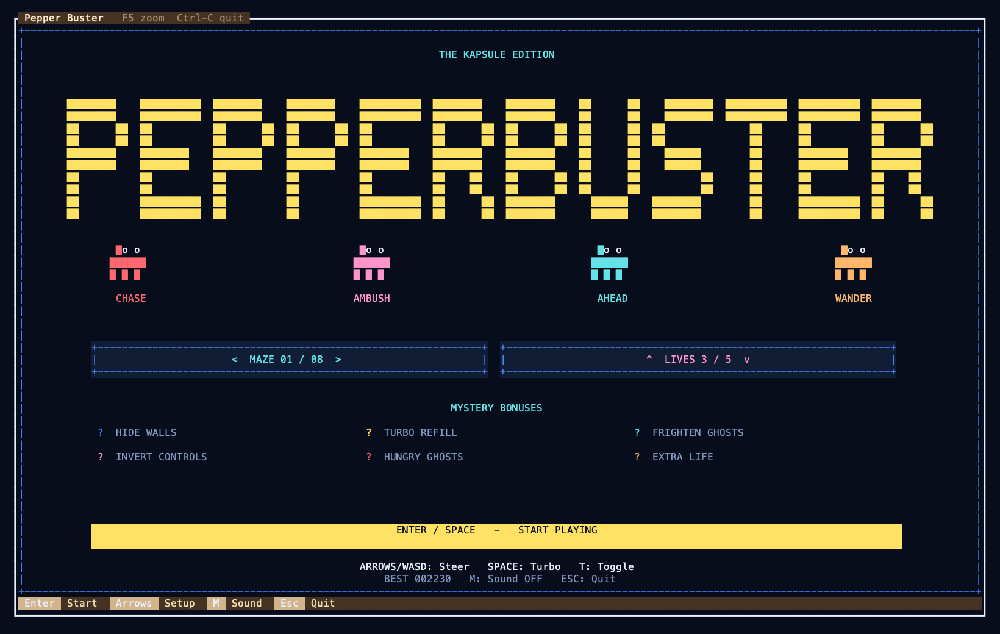
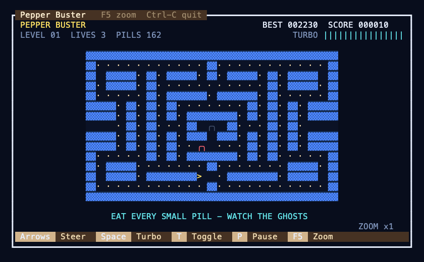
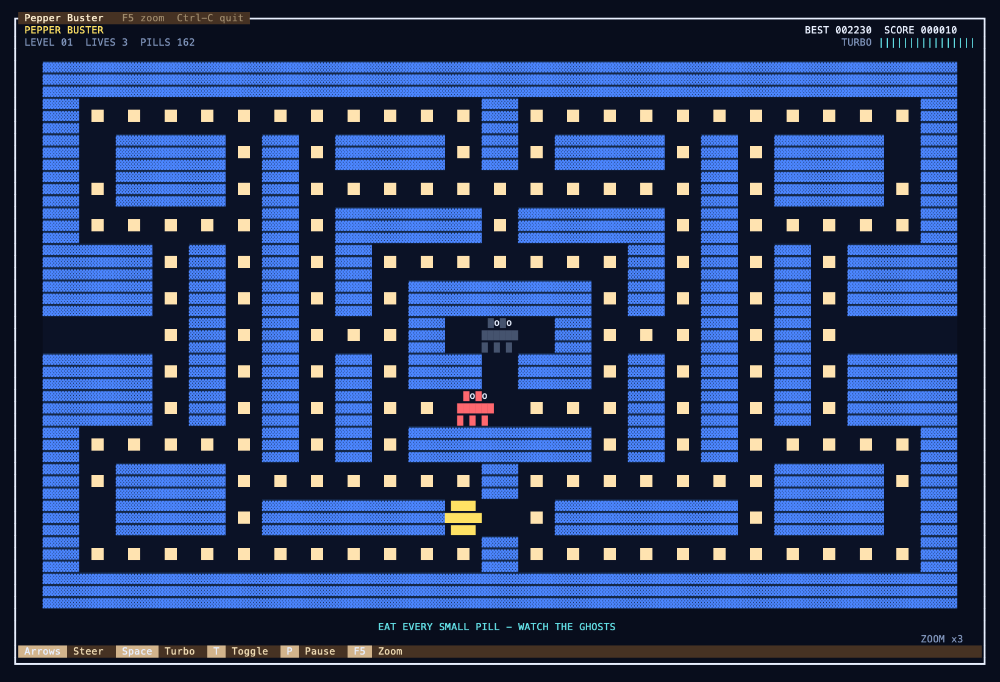

# Pepper Buster — Kapsule

A playable character-cell adaptation of Miguel Vanhove's **Pepper Buster**
CPC/GX4000 game (the `games/pacman` project). The eight original mazes and the
50 Hz game rules are retained: four ghost personalities, buffered turns,
side tunnels, turbo, power pills and mystery bonuses.



## Play

With the [reference Kapsule reader](https://github.com/redbug26/kapsule-rust),
run this directory directly:

```sh
kapsule applications/pepper_buster
```

Or import the complete directory into a compatible Kapsule player. In KKC,
copy it under the data directory's `applications/pepper_buster/` and use the
internal launcher `kkc-lua-app:pepper_buster`.

The only descriptor is `apps.toml`. Keep `app.lua`, `game.lua`, `view.lua` and
`levels.lua` beside it. No external executable or audio decoder is required.

| Control                           | Action                                                                 |
| --------------------------------- | ---------------------------------------------------------------------- |
| Enter / Space in the menu         | Start a new game.                                                      |
| Left / Right in the menu          | Choose one of the eight starting mazes.                                |
| Up / Down in the menu             | Choose 1–5 starting lives.                                             |
| Arrows / WASD (also ZQSD) in play | Steer; the requested turn is buffered until possible.                  |
| Hold Space                        | Turbo while energy remains.                                            |
| T                                 | Toggle turbo; convenient on terminals with limited held-key reporting. |
| P / Esc                           | Pause or resume.                                                       |
| Enter while paused                | Resume.                                                                |
| R while paused                    | Restart with the selected settings.                                    |
| Q while paused or after game over | Return to the menu.                                                    |
| M                                 | Toggle terminal-bell effects (off by default).                         |
| F5                                | Toggle the host's window/full-screen mode.                             |
| Esc in the menu                   | Quit.                                                                  |

Focus loss pauses the game and releases turbo. Small windows below 30×12
suspend simulation until enlarged. The best score is saved on death, maze
completion or return to the menu in `state/highscore.txt`. Writes are best
effort; browser players may retain this data only for the current session.

## Use the available space

The game selects the **largest integral zoom** that fits the entire 25×15
maze: a tile occupies 2×1 character cells at ×1, 4×2 at ×2, 6×3 at ×3, and so
on. Actors and power pills scale with the maze. Zoom is recalculated on every
resize and F5 transition; game progress is preserved. On terminals too small
for the full maze, the viewport follows the player instead.

Examples for the reference reader (dimensions include the host border):

| Terminal | Automatic maze zoom |
| -------- | ------------------- |
| 80×24    | ×1                  |
| 160×50   | ×2                  |
| 160×54   | ×3                  |
| 240×70   | ×4                  |

The menu uses the entire content area, with a scalable block-letter title,
maze/life selectors and a full-width start button. A compact menu is used on
smaller windows.





These previews reconstruct actual reference-reader terminal output, including
colors, rather than a separate mockup renderer.

## Rules

- Small pills score **10**; clear all of them to advance. Power pills and `?`
  bonuses score **50**. Power pills are not required to finish a maze.
- Frightened ghosts reverse and flee for ten seconds. Eating them in sequence
  scores **50, 100, 200, 400**. Their eyes take the shortest directed path back
  home, then become active again.
- Red pursues the player; pink aims halfway between the player and red; cyan
  aims three cells ahead; orange chooses randomly. They avoid reversing unless
  trapped. Ghosts leave home 130 simulation ticks apart.
- A mystery pickup appears at its original map location every 400–910 ticks.
  Its outcome is hidden walls, turbo refill, frightened ghosts, inverted
  controls, hungry ghosts (all pursue like red), an extra life (maximum five),
  or no effect. Timed effects last 500 ticks.
- Turbo doubles the player's speed and consumes one gauge unit every eight
  ticks. A life starts with 16 units; Speedy Pac refills the gauge.
- The eight mazes loop. Ghosts become faster every eight levels, with the
  original speed cap. Losing a life preserves the remaining pills and score.

## Source and adaptation

`game.lua` translates `games/pacman/src/game.c` and its `include/game.h` rules.
`levels.lua` is generated from the authoritative run-length-encoded data in
`games/pacman/assets/source/levels.c`, not its descriptive comments. Both
originate from Miguel Vanhove's Pepper Buster CPC/GX4000 project.

The Kapsule has a new responsive terminal renderer and full-screen menu. It
uses geometric, colored character-cell sprites rather than the ASIC bitmap
sprites. Terminal-bell cues replace the original Arkos music and sound
effects. The source hardware intro and high-score name-entry screen are not
emulated; the Kapsule saves a single best score.

Files:

- `app.lua`: input, menus, pause/death/ready/level transitions and persistence.
- `game.lua`: deterministic simulation, independent of host APIs.
- `view.lua`: responsive layout, automatic zoom, sprites and menu.
- `levels.lua`: all eight imported mazes.
- `tools/import_levels.py`: reproducible importer for the original source.
